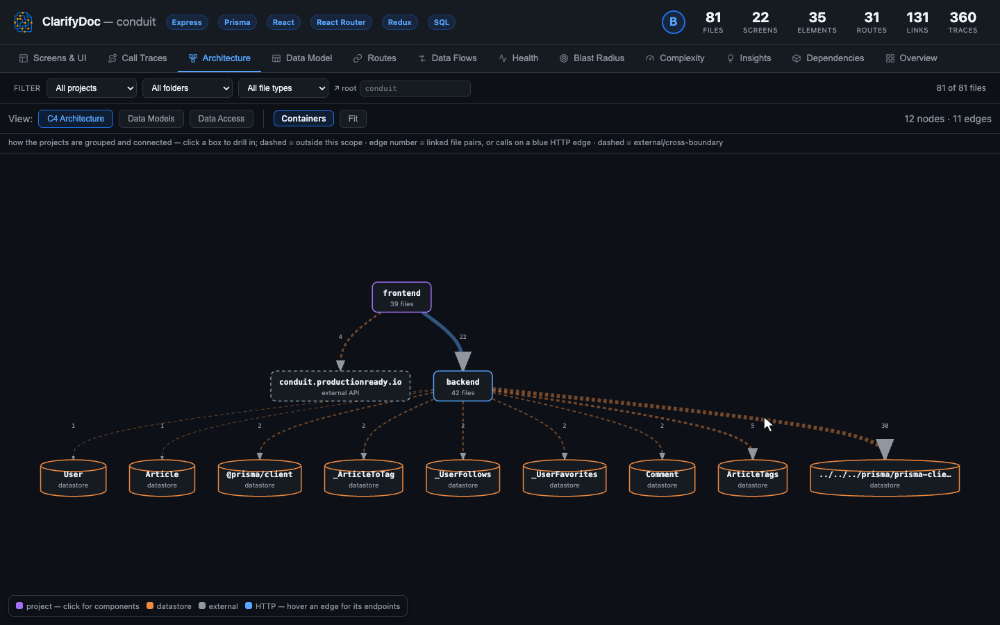

# ClarifyDoc for VS Code

**Which screen calls this endpoint, and which table does it write?** ClarifyDoc
answers that for any codebase, straight from the source, without leaving your
editor.

Open a repo you didn't write and ClarifyDoc traces the chains the app actually
runs: button click → handler → HTTP call → backend route → service → database
table. It follows them across languages, tiers and repos, then puts the answers
where you work: in the editor, in an interactive report, and in your AI agent.



```text
Screen   Checkout · "Place order" click           CheckoutPage.vue
Handler  onSubmit() → orderService.create()       CheckoutPage.vue
API      POST /api/orders                         OrdersController.cs
DI       IOrderService → OrderService             Program.cs
Entity   Orders · INSERT (+ OrderLines)           OrderService.cs
```

*One trace, simplified. Every hop links to its file and line.*

## Get started in a minute

1. Install the extension.
2. Run **ClarifyDoc: Analyze Workspace** from the Command Palette or the
   ClarifyDoc sidebar.
3. The interactive report opens beside your code, and CodeLens, hovers and the
   Problems panel fill in.

No account, no Node.js install, no configuration. The analyzer ships inside the
extension.

## What you get

### Follow a click all the way to the database

**Screens & UI** and **Call Traces** link each screen, button and handler to the
API it calls, the backend route that answers, and the table it reads or writes.
Frontend HTTP calls are matched to backend routes by method and path, even when
the two live in different repos or languages. Calls through dependency injection
resolve to the class the container actually builds (MS DI, Spring, NestJS,
Laravel, FastAPI `Depends` and more), not just to the interface.

### Know what breaks before you change it

**Blast Radius** lists every file a change reaches, with the most tightly
coupled first. The **ClarifyDoc Impact** view in Source Control turns your
uncommitted diff into the screens, routes, entities and tests it affects, with a
risk level, and keeps it current as you work, so you can check before you open
the PR. Compare with a branch and **Compare API Surface** lists what the branch
changes in the API itself — a route removed or moved, a guard lost, a request body
that now requires a field, a call that no longer reaches its route — breaking
first.

### Answers in the editor, where you're reading

- **From a call to its route, and back.** Go to Definition (F12) on an API call's
  URL opens the backend route that serves it, in whichever language and project
  it lives. Find References (Shift+F12) on a route lists the calls that reach it.
- **CodeLens** above every function: callers, callees, complexity and *Traces*.
  Click to jump. Classes get a references lens; routes show method + path →
  handler, then who calls them, from which screens, and what they read and
  write (`1 caller · 2 screens · writes Order`).
- **Hover cards** with complexity, callers/callees and findings; on a call, the
  route it reaches (or why it reaches none); on a route, the path to its data.
- **Call and type hierarchies** across tiers: a controller action's incoming
  calls are the frontend functions that call its route. Used where no language
  extension provides a hierarchy.
- **Go to Symbol in Workspace** (Ctrl+T) finds routes by URL, screens by name or
  route, and entities by name.
- **Show Control Flow**: click the complexity lens to see the function drawn as a
  flowchart. Click a node to jump to its line.
- **Problems panel**: security findings (with their CWE and the routes that reach
  them), overly complex functions and layer violations, at their exact lines,
  with quick fixes. They follow their line while you edit. Dead code can be
  shown as faded text too.
- **Right-click any file → ClarifyDoc** to open its screens, traces or blast
  radius in the report.
- **Go to…**: fuzzy-jump to any route, screen, issue or hotspot.

### See the whole system

The report has tabs for Overview, Screens & UI, Call Traces, Architecture, Data
Access, Data Model (ER diagram), Routes, Data Flows, Health, Blast Radius,
Complexity, Insights and Dependencies. Click a file or symbol in the report and
the source opens beside it. The report is one self-contained `report.html`, so
you can open it in a browser or send it to someone who doesn't have VS Code.

### Find what's dead, risky or tangled

**Health** grades the project and lists security issues, complexity hotspots,
patterns, suggestions and dead code: files that no entry point reaches, and
exports that nothing imports. The dead-code check is tuned for precision, so a
file that might still be used is left off the list.

### Give your AI agent the real map

Copilot's agent mode picks up the analysis automatically over MCP, with no
setup. For Claude Code, Cursor or Windsurf, one command writes the config. Your
agent can then ask which routes exist, who calls a function, what a change
breaks and which table an endpoint writes, and gets answers with `path:line`
references instead of guessing from a few open files. One more command adds a
short section to `AGENTS.md` telling the agent when to use these tools instead of
searching text, and **Ask an AI Agent…** starts a ready-made workflow (before
changing an endpoint, explain a screen's data, review your branch) from where
your cursor is. [Details below.](#ai-agents-mcp)

## Why you can rely on it

- **Deterministic.** The map comes from tree-sitter parsing and pattern-based
  static analysis. No LLM is involved, so the same code always gives the same
  map.
- **Local.** Nothing is uploaded and nothing is sent to a model. No account, no
  telemetry.
- **Honest about uncertainty.** Every cross-file link is tagged *extracted*,
  *inferred* or *ambiguous*, so you know which ones to double-check.
- **Fast on re-runs.** Files are tracked by content hash and only changed files
  are re-analyzed. Turn on *Analyze on save* to keep the map current while you
  work.
- **Hands off your source.** The analyzer only reads your files and writes to a
  single self-ignoring `.clarifydoc/` folder.
- **MIT licensed.**

## Languages and frameworks

60+ languages, mixed freely in one workspace. A Delphi client, a .NET service
and a React frontend are analyzed as one graph.

| Area | Languages |
|------|-----------|
| **Web** | TypeScript, JavaScript, React, Vue, Svelte, Angular, CoffeeScript, HTML, SCSS / Sass / Less |
| **JVM** | Java, Kotlin, Scala, Groovy, JSP, Spring XML |
| **.NET** | C#, F#, VB.NET, Blazor, XAML |
| **Backend & scripting** | Python, PHP, Ruby, Go, Rust, Perl, Raku, Lua, Elixir, Erlang, Crystal, Haxe |
| **Functional** | Haskell, OCaml, Clojure, Racket, Scheme, Common Lisp |
| **Native & mobile** | C, C++, CUDA, Objective-C, Swift, Zig, Nim, D, V, Dart / Flutter, Qt (QML, `.ui`) |
| **Science & numeric** | R, Julia, Fortran, Mojo |
| **Legacy & shell** | Delphi / Pascal (incl. DFM forms), VB6, VBScript, PowerShell, Bash, Windows batch |
| **Desktop automation** | AutoHotkey, AutoIt, AppleScript |
| **Data & API contracts** | SQL, Prisma, OpenAPI, GraphQL, WSDL, JSight |

Routes come from Express, NestJS, Next.js, ASP.NET, Spring, Django, FastAPI,
Flask, Laravel, Rails, Gin, Actix, Axum and others. Tables come from ORMs such as
EF Core, Hibernate / JPA, TypeORM, Sequelize, Mongoose, Prisma, SQLAlchemy,
Django ORM, Eloquent, Doctrine, ActiveRecord, GORM and Diesel, as well as from
plain SQL.

## Built for

- **Onboarding** to a codebase you didn't write.
- **Legacy modernization**: scoping a rebuild of a system nobody fully remembers.
- **Refactoring and code review**, with the blast radius in view.
- **Audits and due diligence**: a full inventory of routes, tables, packages and
  security findings.
- **AI-assisted development**: grounding your agent in the architecture you
  actually have.

---

## How it runs

The analyzer is **bundled inside the extension** and runs in an **isolated
child process**:

- **No external analyzer.** No global install, no `npx` download, no dependency
  on a repo checkout. The CLI and all its tree-sitter WASM grammars ship in the
  VSIX.
- **No Node.js required.** It uses `node` from your `PATH` if present, otherwise
  falls back to VS Code's own runtime, so it works out of the box.
- **Your source files are never modified.** The analyzer only reads them. What it
  writes goes to one directory, `.clarifydoc/` in the project (see below).
- **Remote & trust aware.** It runs on the remote/WSL/Codespaces host, requires a
  trusted workspace to analyze, and declines virtual workspaces.

## Where the analysis lives

`<project>/.clarifydoc/<name>/` holds `project-summary.json`, `report.html` and
the per-file JSON. That location is deliberate: it is exactly where
`clarifydoc analyze` writes and where `clarifydoc mcp` looks, so **any AI agent
opened on your project finds the map with no configuration**, and a CLI run
shares one copy — and one incremental cache — with this extension.

It stays out of your way:

- **Invisible to git.** The analyzer drops a `.gitignore` containing `*` inside
  that directory, so it ignores itself. Nothing shows up in `git status`, and
  your own `.gitignore` is never touched. (Want to commit the map so teammates
  and CI agents get it without scanning? Empty that file — it is only written
  when absent.)
- **Invisible to search.** VS Code's search and Quick Open honour ignore files,
  so the report never turns up in results.
- **Never analyzed.** `.clarifydoc/` is excluded from discovery, so a scan
  cannot eat its own output.

Prefer the project tree completely untouched? Set `clarifydoc.storage` to
`global` and everything goes to the extension's private storage
(`<globalStorage>/analyses/…`) instead. That also happens automatically when the
workspace is read-only.

## Excluding code from the map

Put a `.clarifydoc/ignore` file next to the analysis and list what to leave out,
in ordinary **gitignore syntax** — patterns relative to the project root,
`!` to re-include, `#` for comments:

```gitignore
# Vendored third-party source: Delphi has no package manager, so component
# libraries live in the tree — their demos and tests are not this project.
/Library/mORMot-master/*

# …but keep our own patched fork.
!/Library/mORMot-master/OurFork/**
```

Ignored files are not analyzed at all: they contribute no symbols, screens,
data sources or tables, and the directory is also skipped by framework and
sub-project detection — so vendored code stops diluting the report, the health
score and the MCP answers.

A `.clarifydocignore` at the project root works too; both files are inherited
from parent directories, and `.clarifydoc/ignore` is read second in each
directory so it has the final say.

The quickest way in: right-click a folder in the Explorer → **Ignore Folder in
ClarifyDoc**. It appends the folder (anchored, `/path/to/folder/`) to the
workspace's `.clarifydocignore`, which you can commit so the CLI and your team
skip it too. An ignored folder is not even walked, so a large tree of clones,
stored data or generated files stops slowing every analysis.

## AI agents (MCP)

The extension publishes the workspace analysis as a **Model Context Protocol** server, so Copilot's agent mode can ask
ClarifyDoc for routes, call traces, blast radius, the data model and the impact of the current diff — grounded in
parsed code, with `path:line` references — instead of inferring it from a few open files.

- **Zero configuration in this editor.** One server per workspace folder, pointed at the analysis this extension
  already produced.
- **One command for other agents.** Run **ClarifyDoc: Set Up MCP for an AI Agent…** and pick Claude Code, Cursor or
  Windsurf — it writes that agent's config for you, merging into whatever is already there. (**Copy MCP Server
  Config** still puts the snippet on your clipboard for anything else.)
- **Configs that keep working.** They point at a launcher in the extension's storage whose path never changes, not at
  the version-stamped extension directory — so an extension update cannot silently break your agent. It also carries
  the Node runtime, so the agent needs no Node install of its own.
- **Nothing to point at a path.** Because the analysis lives in the project, the entry is just a command:

  ```json
  { "mcpServers": { "clarifydoc": { "command": "<globalStorage>/bin/clarifydoc-mcp" } } }
  ```

  The server serves whichever project its working directory sits in, walking up to the project root — so one
  user-level entry covers every repo you open.
- **Read-only by default, but never a dead end.** Agents read the latest analysis and cannot re-scan unless you turn
  on `clarifydoc.mcp.allowAnalyze`. A project with *no* analysis at all is analyzed once, on demand, so an agent is
  useful immediately; a directory lock keeps that run from colliding with one started here or from the CLI. Turn the
  whole thing off with `clarifydoc.mcp.enabled`.

Tools: `clarifydoc_status`, `clarifydoc_search`, `clarifydoc_routes`, `clarifydoc_services`, `clarifydoc_contract`,
`clarifydoc_screens`, `clarifydoc_file`, `clarifydoc_trace`, `clarifydoc_extract`, `clarifydoc_blast_radius`, `clarifydoc_data_model`,
`clarifydoc_data_flows`, `clarifydoc_health`, `clarifydoc_impact`, `clarifydoc_analyze`.

## Commands

All under the **ClarifyDoc** category in the Command Palette:

| Command | What it does |
|---------|--------------|
| Analyze Workspace | Analyze a folder (incremental by default) |
| Analyze Workspace (Full Re-scan) | Ignore the incremental cache |
| Open Report | Show the interactive report (editor or browser) |
| Open Report in Browser | Force the external browser |
| Screens & UI / Call Traces / Blast Radius for This File | Right-click jump, file preselected |
| Show in Architecture / Show Routes | Right-click jump to that tab |
| Show Control Flow | Draw the function under the cursor as a flowchart |
| Go to… | Quick-pick a route / screen / issue / hotspot and jump to it |
| Detect Languages & Frameworks | Quick detection only |
| Impact of Current Git Changes as Markdown | Diff → affected screens/routes/entities, as a document (the Source Control view shows it live) |
| Export Security Findings as SARIF | Write the findings as SARIF 2.1.0, without re-analyzing |
| Ask an AI Agent… | Start an agent workflow, filled in from where your cursor is |
| Tell AI Agents When to Use ClarifyDoc (AGENTS.md) | Add or update the guidance section, after showing a diff |
| Set Up MCP for an AI Agent… | Write the MCP config for Claude Code / Cursor / Windsurf |
| Copy MCP Server Config | Put the MCP config on the clipboard for any other agent |
| Show Output Log | Reveal the ClarifyDoc output channel |

## Settings

| Setting | Default | Description |
|---------|---------|-------------|
| `clarifydoc.storage` | `workspace` | `workspace` (`.clarifydoc/` in the project, self-ignoring) or `global` (extension storage) |
| `clarifydoc.diagnostics.enabled` | `true` | Show findings in the Problems panel |
| `clarifydoc.diagnostics.include` | `security`, `complexity`, `layers` | Categories; add `deadCode` for unused exports and unreachable files as faded text |
| `clarifydoc.diagnostics.complexityThreshold` | `15` | Flag functions at/above this complexity |
| `clarifydoc.codeLens.enabled` | `true` | CodeLens above functions, classes and routes |
| `clarifydoc.hover.enabled` | `true` | ClarifyDoc hover cards |
| `clarifydoc.crossTier.enabled` | `true` | Go to Definition from API calls to routes, Find References on routes, and the route CodeLens/hover |
| `clarifydoc.incremental` | `true` | Reuse cache for unchanged files |
| `clarifydoc.enableLsp` | `false` | Layer-2 LSP enhancement (needs Docker) |
| `clarifydoc.editorLsp.enabled` | `true` | Layer 2 through the editor's own language servers after each analysis (no Docker) |
| `clarifydoc.editorLsp.maxQueries` | `2000` | Definition questions per pass over the editor's language servers |
| `clarifydoc.lspTimeout` | `0` | LSP startup timeout (ms; 0 = analyzer default) |
| `clarifydoc.gitHistory` | `true` | Collect git churn / hotspots |
| `clarifydoc.maxFiles` | `0` | Cap files analyzed (0 = unlimited) |
| `clarifydoc.includeGlobs` | `[]` | Extra include globs |
| `clarifydoc.excludeGlobs` | `[]` | Extra exclude globs |
| `clarifydoc.openReportAfterAnalyze` | `true` | Auto-open the report after analysis |
| `clarifydoc.reportLocation` | `editor` | `editor` (webview) or `browser` |
| `clarifydoc.analyzeOnSave` | `false` | Re-analyze a few seconds after source files change on disk — saves, branch switches, generated files. Runs quietly; an open report is refreshed |
| `clarifydoc.mcp.enabled` | `true` | Publish the analysis to AI agents over MCP |
| `clarifydoc.mcp.allowAnalyze` | `false` | Let an agent trigger a re-analysis |
| `clarifydoc.nodePath` | *(auto)* | Node.js executable to run the analyzer |
| `clarifydoc.cliPath` | *(bundled)* | Advanced: override the bundled analyzer |

## Support

- Website: [clarifydoc.com](https://clarifydoc.com)
- Issues and source: [github.com/clarifydoc/vscode](https://github.com/clarifydoc/vscode/issues)
- Email: [support@clarifydoc.com](mailto:support@clarifydoc.com)

## License

MIT
